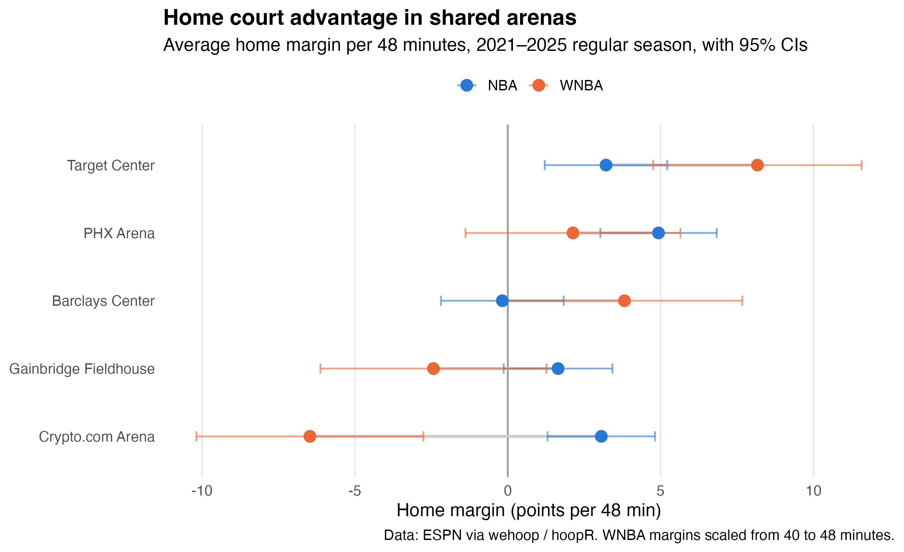

# Does the WNBA get the same home court advantage as the NBA?

Comparing home court advantage in the WNBA and NBA, including teams
that share an arena.

## Key findings
- Home teams win about 54–55% of regular-season games in both leagues (2021–2025).
- After scaling WNBA games to 48 minutes, the average home margin is ~1.5 points
  (WNBA) vs ~1.8 points (NBA), and the difference isn't statistically significant.

## How to run
1. Install packages: `install.packages(c("tidyverse", "wehoop", "hoopR"))`
2. Open `analysis.R` and run it top to bottom.

## Data
Game results from ESPN via the [wehoop](https://wehoop.sportsdataverse.org)
and [hoopR](https://hoopr.sportsdataverse.org) R packages.